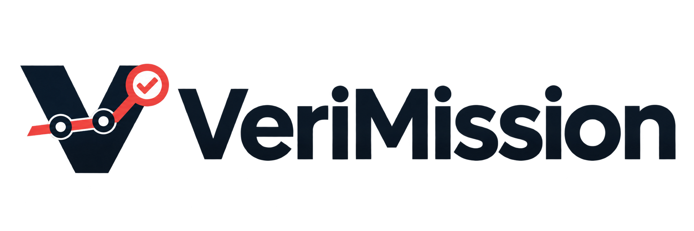

<picture>
  <source media="(prefers-color-scheme: dark)" srcset="assets/branding/verimission-logo-dark.png">
  <source media="(prefers-color-scheme: light)" srcset="assets/branding/verimission-logo-light.png">
  
</picture>

# VeriMission

Local development: [Control 8.4 evidence-qualified quantities](docs/control-8.4-local-preview.md).
This new generation is packaged separately and is not installed or published by these sources.

Evidence-based control for long-running projects with AI agents.

[Brand assets](docs/branding.md) · [Control 8.1 guide](docs/harness-8.1.md) · [Control 8.2 preview](docs/release-v2.2.0-rc.1.md) · [Verification](docs/v8.1-verification.md)

VeriMission provides local harnesses and agent skills for projects that span multiple sessions. It records an explicit mission, acceptance criteria, execution cycles, evidence, claims, retractions, and next steps. Its checks support traceability and bounded conclusions; test quality and semantic correctness still require review.

The harness uses its host's permissions. Installing a skill does not grant permissions or start background work.

## Versions

| Version | Capabilities | Typical use |
| --- | --- | --- |
| Core 7.8 | Mission contract, cycles, checks, claims, retractions, recovery | A smaller control surface for long projects |
| Continuity 7.9 | Evidence scopes, resumption capsules, mission preparation | Work spread across many sessions |
| Control 8.0 | Task dependencies, search, traceability, context, governed operations | Several workstreams and formal acceptance |
| [Control 8.1](docs/harness-8.1.md) | Graph projections, PR reports, explicit run imports, cost accounting | Reviewable evidence across agents |
| [Control 8.2 — public preview](docs/harness-8.2.md) | Native digest producer, protected periodic review, source pinning, automatic boundary consolidation | General long projects, without a domain-tool dependency |

Maintained versions use YAML storage. Binary analysis and Renode skills are published separately in [DisasmLedger](https://github.com/wagmarsouza/disasmledger).

## Control 8.3 — Preview 1

The isolated 8.3 generation adds native case-level preservation gates and a new
`skill-harness-v8-3`, retaining the complete 8.2 core. See [the guide](docs/harness-8.3.md).
See [release notes and downloads](docs/release-v2.3.0-rc.1.md) for verified artifacts and quick-start
instructions. Local qualification passed on Windows and Linux/WSL; published coverage follows actual
test receipts. Earlier releases remain available. Publishing does not install or activate a skill.

```shell
npx skills add wagmarsouza/long-project-agent-harness --skill skill-harness-v8-3
```

Run the installation command only when you want to install it. After installation, ask your agent:
`Use skill-harness-v8-3 for this project; resume the authorized mission and inspect preservation obligations.`

## Requirements

- Python 3.11 or later.
- PyYAML 6.x: `python -m pip install -r requirements.txt`.
- Git for `report-pr`.
- A host that discovers `SKILL.md` folders when using skills.

## Install and invoke

```shell
npx skills add wagmarsouza/long-project-agent-harness --skill skill-harness-v8-1
npx skills add wagmarsouza/long-project-agent-harness --list
```

The [Control 8.2 public preview](docs/release-v2.2.0-rc.1.md) is available as `skill-harness-v8-2`; its periodic policy is opt-in and existing missions must not be reinitialized. The 8.1 examples above remain available.

Other skill IDs: `skill-harness-v7-8`, `skill-harness-v7-9`, `skill-harness-v8-0`.

For manual installation, copy the complete selected folder from `skills/` into the host's skill directory. OpenCode commonly uses `~/.config/opencode/skills/`. Keep all scripts and references; reload the host if required.

```text
Use skill-harness-v8-1 for this project. Resume the existing mission, inspect current evidence, and preserve the authorized contract.
```

Slash commands depend on the host. Installation enables discovery rather than activation in every message.

## Start a mission

```powershell
git clone https://github.com/wagmarsouza/long-project-agent-harness.git
cd long-project-agent-harness
python -m pip install -r requirements.txt
$h = (Resolve-Path '.\harnesses\v8.1\scripts\harness.py').Path
$p = 'C:\path\to\project'
```

Copy the mission and plan templates from `harnesses/v8.1/templates/` into the project. Replace placeholders with real scope, acceptance commands, artifacts, and limits. Review command effects before execution.

```powershell
python -B $h --project $p init --input "$p\mission.json"
python -B $h --project $p review --topic 'first-task'
# Fill plan.json with the returned review and claim IDs.
python -B $h --project $p start --input "$p\plan.json"
python -B $h --project $p check --cycle 1 --criterion C1
python -B $h --project $p close --cycle 1 --outcome verified --next 'Next concrete step'
python -B $h --project $p validate
```

Verified closure requires passing checks and current evidence. A verified cycle does not by itself complete the mission. Existing YAML missions start with `resume` and `validate`; do not reinitialize or edit the store directly.

## Migrate a legacy SQLite mission

If `.harness/state.sqlite` exists and YAML has not yet been created:

```powershell
python -B $h --project $p migrate-sqlite
python -B $h --project $p validate
python -B $h --project $p resume
```

Migration validates the database, imports state and audit history, records provenance, and preserves the source. Subsequent changes use `.harness/state.yaml`. Writes use a checksum, locking, and atomic replacement. Checksums detect accidental changes; they do not authenticate operators or establish semantic truth.

## Control 8.1 commands

```powershell
python -B $h --project $p graph --format mermaid --output MISSION_GRAPH.mmd
python -B $h --project $p report-pr --base main --head HEAD --format markdown --output PR_REPORT.md
python -B $h --project $p adapter-template --agent codex
python -B $h --project $p run-import --agent codex --input "$p\run.json"
python -B $h --project $p cost-summary
```

Graph formats: JSON, Mermaid, DOT. Import adapters: Codex, OpenCode, Claude, Hermes. Imports use an explicit schema and hashed sources; native logs are not parsed automatically. Cost reports separate actual, estimated, and unpriced amounts. Unknown values remain null.

Read the [usage guide](docs/harness-8.1.md), [implementation plan](docs/v8.1-plan.md), and [schema reference](harnesses/v8.1/references/v81-projections-and-runs.md).

## Verification

```shell
uv run --with pyyaml python -B -m unittest discover -s harnesses/v8.1/tests
uv run --with pyyaml python -B -m unittest discover -s skills/skill-harness-v8-1/tests
```

Apply the same pattern to earlier version folders. Tests use local fixtures. See [verification details](docs/v8.1-verification.md).

## Publication and reuse

Do not publish credentials or restricted evidence. See [SECURITY.md](SECURITY.md). No reuse license has been selected; public visibility alone does not grant general modification or redistribution rights. At the owner's request, Control 8.3 retains that same policy; it does not add a different license. Historical source references retain their original wording. Current public presentation and Control 8.1 guidance use English.
