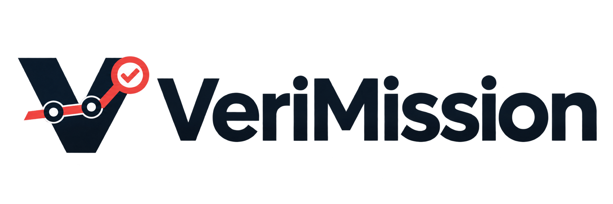
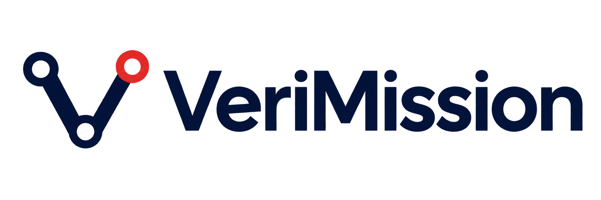

# Identidade visual VeriMission

Os arquivos desta página usam fundo transparente e possuem versões para temas claro e escuro. A versão 1 é a assinatura principal atualmente exibida no README. A versão 2 é uma alternativa mais minimalista, preservada para comparação e usos futuros.

## Versão 1 — principal

<picture>
  <source media="(prefers-color-scheme: dark)" srcset="../assets/branding/verimission-logo-dark.png">
  <source media="(prefers-color-scheme: light)" srcset="../assets/branding/verimission-logo-light.png">
  
</picture>

- Tema claro: [`verimission-logo-light.png`](../assets/branding/verimission-logo-light.png)
- Tema escuro: [`verimission-logo-dark.png`](../assets/branding/verimission-logo-dark.png)

## Versão 2 — rota de evidências

<picture>
  <source media="(prefers-color-scheme: dark)" srcset="../assets/branding/verimission-logo-v2-dark.png">
  <source media="(prefers-color-scheme: light)" srcset="../assets/branding/verimission-logo-v2-light.png">
  
</picture>

- Tema claro: [`verimission-logo-v2-light.png`](../assets/branding/verimission-logo-v2-light.png)
- Tema escuro: [`verimission-logo-v2-dark.png`](../assets/branding/verimission-logo-v2-dark.png)

## Nomenclatura pública

- **VeriMission Core 7.8** — ID técnico `skill-harness-v7-8`.
- **VeriMission Continuity 7.9** — ID técnico `skill-harness-v7-9`.
- **VeriMission Control 8.0** — ID técnico `skill-harness-v8-0`.

Os IDs técnicos das skills de harness permanecem estáveis. As skills `binary-analysis-profile` e `renode-bench` usam agora a marca [DisasmLedger](https://github.com/wagmarsouza/disasmledger), em repositório próprio.
